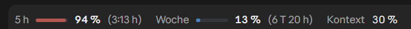
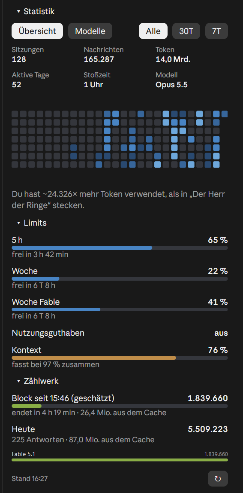
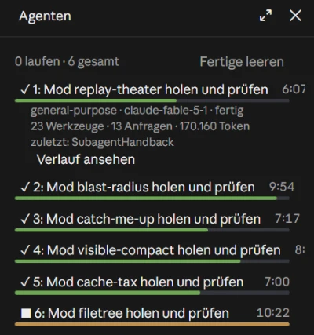
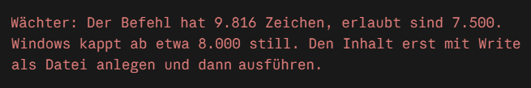
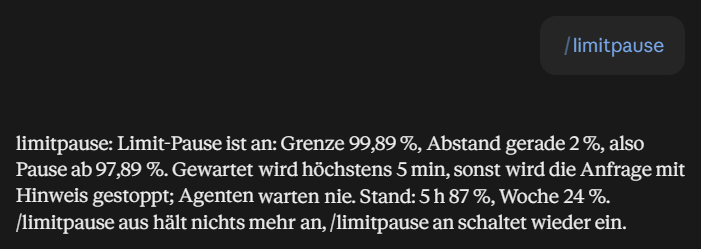
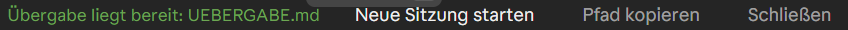
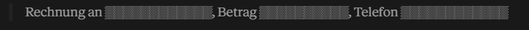
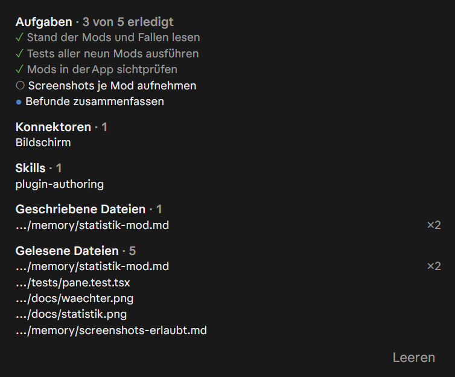
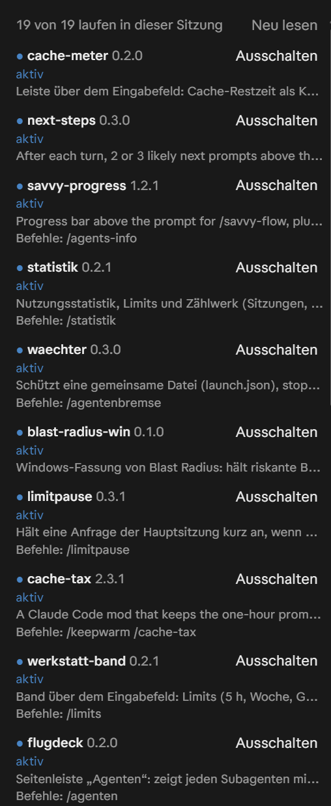

# werkstatt-mods

Neun Mods für Claude Code aus der Werkstatt von Dennis_mit_2n. Ein Mod ist ein Plugin mit einem Code-Modul, das Claude Code bei Ereignissen aufruft: Seitenleisten, ein Band über dem Eingabefeld, Schutzregeln. Alle neun sprechen Deutsch und Englisch (Einstellung `language`), laufen in der Desktop-App und im Terminal und schicken nichts nach außen.

**Seite mit Bildern, Installationszeilen und Prompts:** https://dennismit2n.github.io/mods.html · [Neuigkeiten](https://dennismit2n.github.io/werkstatt.html#mods-neuigkeiten)

| Mod | Was er tut | Befehl |
| --- | --- | --- |
| [statistik](./statistik) | Seitenleiste mit Nutzungsstatistik (Sitzungen, Nachrichten, Token, Kalender), Limits und Zählwerk | `/statistik` |
| [werkstatt-band](./werkstatt-band) | Band über dem Eingabefeld: 5 h, Woche, Woche je Modell, Guthaben und Kontext in einer Zeile; dazu News-Erinnerung und Textprüfer für eigene Repos | `/limits` |
| [waechter](./waechter) | Schützt eine gemeinsame Datei, stoppt zu lange Shell-Befehle, bremst parallele Subagenten, wählt ihnen ein sparsames Modell und verkleinert Browser-Fotos | `/agentenbremse` |
| [limitpause](./limitpause) | Hält jede Modell-Anfrage vor der Limit-Grenze an und macht nach dem Reset von selbst weiter | `/limitpause` |
| [flugdeck](./flugdeck) | Seitenleiste „Agenten“: jeder Subagent mit Laufbalken, Zeit und letztem Werkzeug, dazu die anderen Sitzungen der App | `/agenten` |
| [uebergabe](./uebergabe) | Erinnert ab einer Kontextgrenze an eine Übergabe, lässt Claude sie ausführlich schreiben und startet damit eine frische Sitzung | `/uebergabe`, `/stand` |
| [inventar](./inventar) | Seitenleiste „In diesem Chat“: Aufgaben, benutzte Konnektoren, Skills, Links und die gelesenen und geschriebenen Dateien | `/inventar` |
| [sichtschutz](./sichtschutz) | Schwärzt beim Bildschirmteilen Mailadressen, Nummern, Beträge und eigene Wörter im Verlauf | `/sichtschutz` |
| [schalttafel](./schalttafel) | Seitenleiste „Mods“: alle Mods mit Version und Befehlen, dazu ein Schalter für die nächste Sitzung | `/mods` |

Die Mods arbeiten einzeln. Zusammen greifen sie ineinander: Die Knöpfe „Statistik“ und „Agenten“ im Band klappen die beiden Seitenleisten auf und zu.

## So sehen sie aus

<p></p>

<p> </p>

<p></p>

<p></p>

<p></p>

<p></p>

<p> </p>

## Installation

Im Terminal, am Prompt von Claude Code, je Mod eine Zeile:

```
/plugin install statistik --marketplace Dennismit2n/werkstatt-mods
/plugin install werkstatt-band --marketplace Dennismit2n/werkstatt-mods
/plugin install waechter --marketplace Dennismit2n/werkstatt-mods
/plugin install limitpause --marketplace Dennismit2n/werkstatt-mods
/plugin install flugdeck --marketplace Dennismit2n/werkstatt-mods
/plugin install uebergabe --marketplace Dennismit2n/werkstatt-mods
/plugin install inventar --marketplace Dennismit2n/werkstatt-mods
/plugin install sichtschutz --marketplace Dennismit2n/werkstatt-mods
/plugin install schalttafel --marketplace Dennismit2n/werkstatt-mods
```

Beim ersten Mal fragt Claude Code `Add marketplace?` (mit `y` bestätigen), dann nach dem Geltungsbereich (Enter für den Nutzer) und nach den Einstellungen des Mods, etwa der Sprache. Danach läuft der Mod sofort in dieser Sitzung und in jeder weiteren.

Aus der Shell: `claude plugin install <mod> --marketplace Dennismit2n/werkstatt-mods`.

In der Desktop-App, wo `/plugin` nicht läuft: + neben dem Eingabefeld, dann Plugins, Marketplace hinzufügen mit `Dennismit2n/werkstatt-mods`, dann das Plugin hinzufügen.

Einstellungen lassen sich später in `/config` ändern; jedes README nennt sie.

## Voraussetzungen

- Claude Code ab 2.1.287 (Mods sind Early Access, die Schnittstelle kann sich zwischen Versionen ändern). Geprüft mit der Desktop-App 2.1.309 unter Windows 11.
- `statistik` braucht Node.js im PATH; `limitpause` Node.js, PowerShell oder sh.
- Die Limits und die Sitzungsliste kommen aus den App-Werkzeugen der Desktop-App; im Terminal zeigen die Mods die Zahlen der Engine.

## Entwickeln

Jeder Mod liegt in seinem Ordner: `.claude-plugin/plugin.json` (Manifest mit `userConfig`), `hooks/register.ts(x)` (das Modul), `hooks/text.ts` (alle Texte, Deutsch und Englisch), `types/index.d.ts` (Zustand) und `tests/`. Prüfen mit `claude plugin validate <Ordner>` und `claude plugin test <Ordner>`. `hooks/limits.ts` liegt gleichlautend in `statistik`, `werkstatt-band` und `limitpause`; beim Ändern alle drei Kopien gleich halten.

Zum Ausprobieren ohne Installation: `claude --plugin-dir ./flugdeck`, oder die Ordner in `~/.claude/settings.json` unter `env.CLAUDE_CODE_PLUGIN_DIRS` eintragen (unter Windows mit `;` getrennt).

## English

Nine mods for Claude Code: a statistics pane, a one-line limits band, a guard (protected file, command length, agent brake, a cheaper model per subagent type, smaller browser screenshots), a limit pause that waits for the reset instead of failing, an agents pane with the session’s subagents and the app’s other sessions, a handoff that moves a long chat to a fresh session, a chat inventory pane, a screen guard that masks private data while you share your screen, and a switchboard listing every mod. Every mod has a `language` setting (`de` or `en`). Install with `/plugin install <mod> --marketplace Dennismit2n/werkstatt-mods`; each folder’s README describes the mod in German, the settings tables name every option. Screenshots, install lines and ready-made prompts in all fourteen languages of the workshop: https://dennismit2n.github.io/mods.html

## Lizenz

MIT, siehe [LICENSE](./LICENSE).
