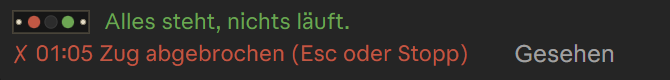

# ampel

Eine Ampel über dem Eingabefeld, die jederzeit zeigt, ob in der Sitzung gerade etwas läuft. Entstanden aus einem echten Moment: Während ein langer Build im Hintergrund lief, war nirgends zu sehen, ob noch etwas arbeitet oder ob ich es aus Versehen gestoppt hatte. Texte auf Deutsch oder Englisch.

<p></p>

## Was die Mod tut

- **Grün:** „Alles steht, nichts läuft.“ Claude ist fertig, und im Hintergrund arbeitet nichts mehr.
- **Gelb:** Claude arbeitet, mit Uhr und dem laufenden Werkzeug, etwa „Claude arbeitet 1:05 · Bash: npm run build“. Wartet Claude auf deine Antwort, steht das da. Gelb bleibt auch nach dem Zug, solange im Hintergrund noch etwas läuft: „Claude ist fertig, im Hintergrund läuft noch“.
- **Was im Hintergrund läuft**, je eine Zeile mit Namen und Laufzeit: Hintergrundbefehle (`run_in_background`), Monitore, Unteragenten und laufende Nebensitzungen der Desktop-App, zum Beispiel „▸ Befehl: Build 3:10“. Geplante Weckrufe (`/loop`, ScheduleWakeup) stehen als „1 Weckruf geplant“ dabei.
- **Rot:** Etwas wurde abgebrochen, gestoppt oder ist fehlgeschlagen, je eine Zeile mit Uhrzeit:
  - ein Zug, den du mit Esc oder Stopp abgebrochen hast,
  - ein Zug, der mit einem Fehler endete,
  - ein Hintergrundbefehl mit Fehlercode („fehlgeschlagen (Exit 3)“),
  - ein unterbrochener Befehl,
  - ein mit TaskStop gestoppter Lauf,
  - ein fehlgeschlagener oder gestoppter Agent.

  Die roten Zeilen bleiben stehen, bis du auf „Gesehen“ klickst. So siehst du auch später noch, ob du aus Versehen etwas gestoppt hast.

Rot und Gelb können zusammen leuchten, wie an einer echten Ampel: Wurde etwas abgebrochen und Claude arbeitet trotzdem weiter, siehst du beides. Ist nach einem Hintergrundlauf alles fertig, meldet die Mod das einmal kurz („Ampel grün: Alles ist fertig.“).

Die Mod liest nur mit, was die Engine ohnehin meldet: Beginn und Ende jedes Zugs, Werkzeugaufrufe, Meldungen fertiger Hintergrundläufe, die Agentenliste und am Zugende die Liste der laufenden Hintergrundarbeit. Sie ruft kein Modell auf und schickt nichts nach außen. Die Nebensitzungen liest sie über das App-Werkzeug `list_sessions`, und nur, wenn das ohne Freigabe-Dialog geht.

## Bedienung

- Die Ampel steht immer über dem Eingabefeld, auch im Leerlauf.
- „Gesehen“ quittiert alle roten Zeilen.
- `/ampel` gibt denselben Stand als Text aus, etwa für das Terminal oder zum Kopieren.

## Einstellungen

Beim Installieren fragt Claude Code danach, später änderbar in `/config`:

| Einstellung | Standard | Bedeutung |
| --- | --- | --- |
| `language` | `de` | Sprache der Ampel, `de` oder `en` |
| `showSessions` | `true` | Laufende verknüpfte Sitzungen der Desktop-App mit anzeigen (alle 20 s) |
| `toastWhenDone` | `true` | Kurze Meldung, sobald nach einem Hintergrundlauf alles fertig ist |

## Voraussetzungen

Claude Code ab 2.1.287 (Mods sind Early Access), geprüft mit der Desktop-App 2.1.325 unter Windows 11. Die Nebensitzungen gibt es nur in der Desktop-App.

## Installation

Im Terminal, am Prompt von Claude Code:

```
/plugin install ampel --marketplace Dennismit2n/werkstatt-mods
```

Aus der Shell: `claude plugin install ampel --marketplace Dennismit2n/werkstatt-mods`. In der Desktop-App: + neben dem Eingabefeld, dann Plugins, Marketplace hinzufügen mit `Dennismit2n/werkstatt-mods`, dann das Plugin hinzufügen.

Zum Entwickeln aus einem Ordner: `claude --plugin-dir <Pfad zu ampel>`, oder den Pfad in `~/.claude/settings.json` unter `env.CLAUDE_CODE_PLUGIN_DIRS` eintragen (mehrere Pfade unter Windows mit `;` trennen). Die Desktop-App lädt Mods beim Start einer Sitzung; Änderungen gelten ab der nächsten Sitzung.

## Prüfen

`claude plugin validate <Ordner>` und `claude plugin test <Ordner>` (9 Tests).

## English

A traffic light above the prompt that always shows whether anything in the session is still running. Green: nothing is running. Amber: Claude is working (with a clock and the current tool), or something still runs in the background: background commands, monitors, subagents and running linked sessions of the desktop app, each with its name and run time. Red: something was interrupted, stopped or failed (an interrupted turn, a background command with a non-zero exit code, a TaskStop, a failed agent); red lines stay until you press "Seen". Red and amber can light together. `/ampel` prints the same state as text. Set `language` to `en` for English texts. Install with `/plugin install ampel --marketplace Dennismit2n/werkstatt-mods`.

Lizenz: MIT.
